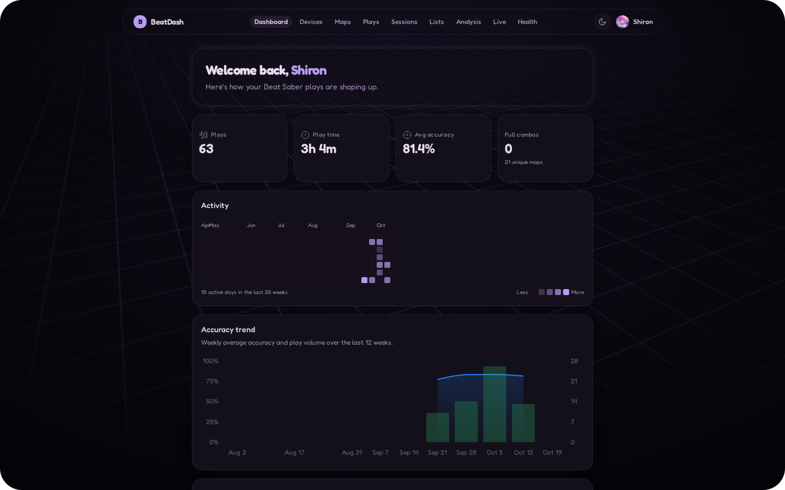
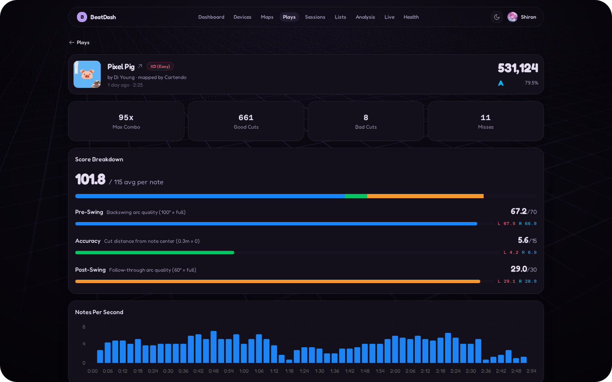
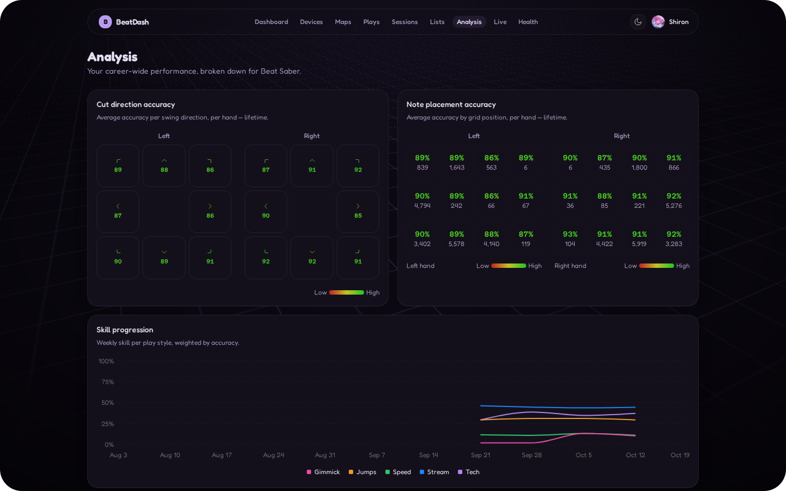
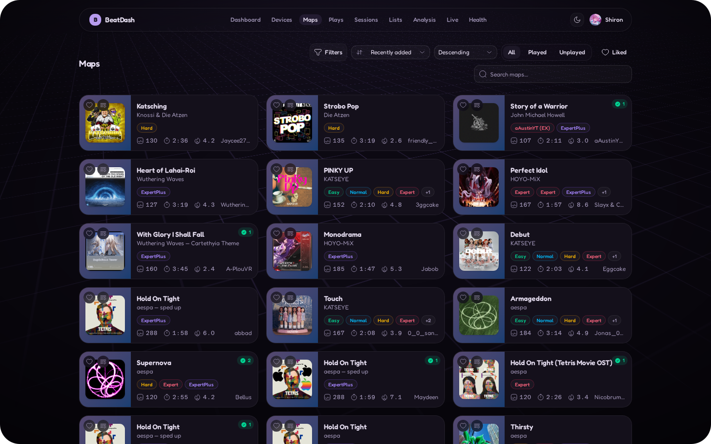
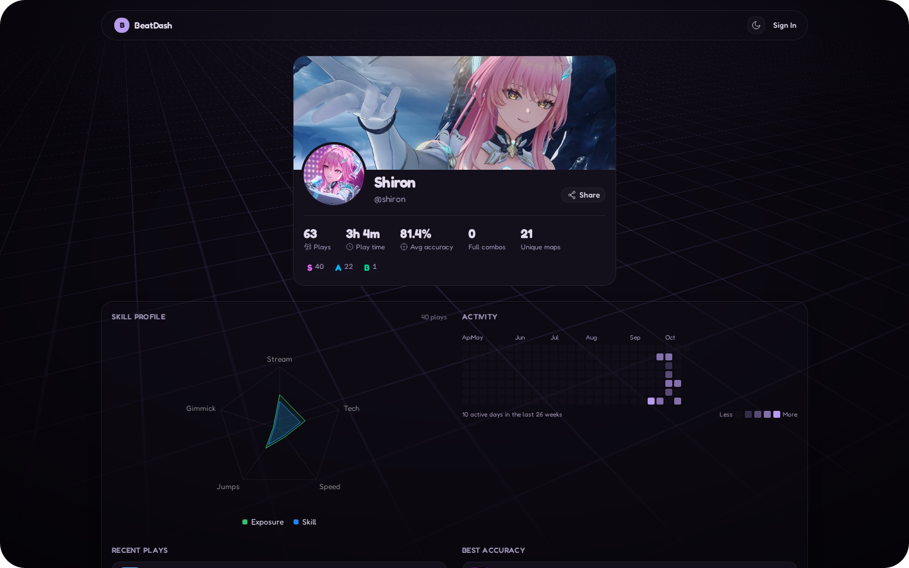

# BeatDash

Beat Saber profile and analytics dashboard. A Beat Saber mod streams gameplay data to a web dashboard (React) backed by an ASP.NET Core API and PostgreSQL.

<p align="center">
  
</p>

> **⚠️ Heavy Development Notice**
>
> BeatDash is in early development. Features are incomplete, the UI is rough, things will break, and the auth flow is not production-hardened. Expect breaking changes at any time. Do not rely on this for anything yet.

---

## Features

BeatDash pairs your VR headset with a web dashboard. When you start a song in-game, the mod streams the map and your gameplay to the dashboard, where it's stored and turned into per-play and career-wide stats.

The dashboard (shown above) opens on an overview of your account: total plays, play time, average accuracy, an activity heatmap, an accuracy trend, a skill radar, and your recent and best plays.

<table>
  <tr>
    <td width="50%"></td>
    <td width="50%">
      <h3>Per-play breakdown</h3>
      <p>Every play is scored note by note: the score split into pre-swing, accuracy, and post-swing components, good/bad cuts and misses, a notes-per-second graph, a combo and miss timeline, per-hand performance, saber motion, and a note-position grid.</p>
    </td>
  </tr>
  <tr>
    <td width="50%">
      <h3>Career analysis</h3>
      <p>Every play aggregated into lifetime views: accuracy per swing direction for each hand, accuracy by note grid position for each hand, and skill progression per play style (stream, tech, speed, jumps, gimmick) over time.</p>
    </td>
    <td width="50%"></td>
  </tr>
  <tr>
    <td width="50%"></td>
    <td width="50%">
      <h3>Beatmap catalog</h3>
      <p>Browse the maps you've played. Filter by played, unplayed, or liked, search by name, and see difficulties, note counts, length, star rating, and cover art for each.</p>
    </td>
  </tr>
  <tr>
    <td width="50%">
      <h3>Public profile</h3>
      <p>A shareable page for your account with only the sections you choose to make public — banner and avatar, career stats, a skill radar, an activity heatmap, and your recent and best plays. Anyone with the link can view it; you stay in control of what's shown.</p>
    </td>
    <td width="50%"></td>
  </tr>
</table>

### Also included

-   **Live tracking** — maps and score appear on the dashboard in real time as you play
-   **Device pairing** — link one or more Beat Saber installs to your account with a PIN
-   **Lists** — group maps into named collections
-   **Health & fitness (optional)** — opt-in calorie, active-time, and heart-rate insights per play and per session. Wearable heart rate is pushed through the **Honami Sensor Proxy**, a device-agnostic companion app that forwards your smartwatch's sensor data to BeatDash. The app is currently in development — the first version will be available on GitHub soon™.

---

## Pairing & Setup

### Downloadable releases

Download binaries from [GitHub Releases](https://github.com/iamshiron/BeatDash/releases)
(not the automatically generated source-code archives):

- **Mod:** automated downloads are deferred. Follow [Building the mod locally](#building-the-mod-locally).
- **Server:** `BeatDash-server-<version>-win-x64.zip` or
  `BeatDash-server-<version>-linux-x64.zip`. Each is a single ZIP containing the server,
  bundled dashboard, admin CLI, commented `appsettings.example.json`, and startup/backup
  instructions. Install the **.NET 10 ASP.NET Core Runtime** for your OS; the full SDK,
  Node.js and pnpm are not required. Provision PostgreSQL 17 and RustFS separately.

Extract the full server ZIP, copy `appsettings.example.json` to `appsettings.json`,
replace its credentials and JWT secret, then run `dotnet Shiron.BeatDash.API.dll`.
Open **http://localhost:1811** and log in with the configured administrator account.
The sample enables database migrations on startup and **disables public signup**.
Read the included comments before binding the server to your network.

`Registration:DisableSignup=true` (or `Registration__DisableSignup=true`) removes the
entire `/api/auth/register` backend route: direct requests return 404 and cannot create
users. Login and administrator seeding remain available. Restart after changing it.
The dashboard also hides signup and blocks its registration form, but the backend
restriction is authoritative. JSON is loaded beside the server binaries; environment
variables and command-line configuration override it. Existing `.env` settings work too.

The mod pairs with your account once, then stays connected:

```
1. Register an account on the web dashboard (email + password)
2. Log in
3. Request a 6-digit PIN from the dashboard
4. Enter the PIN in the Beat Saber mod settings
5. The mod exchanges the PIN for tokens and stays connected
```

The mod authenticates over a WebSocket connection to the API. Access tokens expire every 15 minutes and refresh automatically — you only need to pair once per device.

The ASP.NET Core server hosts both the API and the built dashboard. See the developer setup below to run it with `dotnet`; Docker or Podman is only needed for infrastructure.

1.  [Build and install the mod locally](#building-the-mod-locally).
2.  Complete the developer setup below, then start the backend and dashboard:
    ```sh
    dotnet run --project src/BeatDash.API
    ```
3.  Open the dashboard in your browser, register, and follow the pairing flow above

---

## For Developers

### Release versions

GitVersion 6.8.2 generates assembly version attributes and a per-assembly
`GitVersionInformation` class during `dotnet build`/`publish`; no tracked source
files or package manifests are rewritten.

| Component | Config | Version tag |
|---|---|---|
| Backend, CLI and web app | `GitVersion.yml` | `v1.2.3` |
| Beat Saber mod | `GitVersion.Mod.yml` | `beatdash-mod/v1.2.3` |

Mod-only commits are ignored by the backend stream. The mod stream considers
`src/BeatDash.Mod`, shared contracts in `src/BeatDash.Data`, `external` libraries,
their tests, and shared MSBuild/NuGet/CI configuration. Backend/web-only changes
do not increment the mod. Shared or mixed commits affect both streams; add any
new shared projects to the mod config's path allowlist. Shared assemblies are
stamped with the backend stream; the mod assembly and BSIPA manifest use the mod
stream.

Conventional commits select the next version: `feat:` increments minor,
`fix:`/`perf:` increment patch, and `type!:`/`type(scope)!:` increment major.
Feature branches use their branch name as the prerelease label; release branches
are named `rel/<semver>` and use its label (`rel/0.1.0-alpha` builds `alpha`).
Continuous Delivery builds remain prereleases until tagged. Tags are
independent, even when both releases point at the same commit.

Use a full clone with tags (`git fetch --unshallow --tags` for a shallow clone).
Builds do not fetch automatically. To inspect and test versions:

```sh
dotnet tool restore
dotnet tool run dotnet-gitversion /config GitVersion.yml
dotnet tool run dotnet-gitversion /config GitVersion.Mod.yml
python3 tools/versioning/test_versions.py
```

The public status endpoint `GET /api/health` returns `message` and `version`.
The web app reads that version at runtime rather than maintaining a separate
frontend build version. The mod still needs a local Beat Saber installation to
build and package, as described below.

### Publishing GitHub releases

`.github/workflows/release.yml` publishes actual GitHub Releases on pushes of
`v<version>` (server). The tag version must
match GitVersion. Stable tags create normal releases; prerelease tags create prereleases.
Releases do not change GitHub's global `latest` pointer. No Docker image is built or pushed.
The step-by-step release procedure is in [docs/release-pipeline.md](docs/release-pipeline.md).

Windows x64 and Linux x64 server releases build on standard GitHub-hosted runners.
Automated mod releases are deferred; no self-hosted runner or `mod-release` environment
is needed. The mod retains its independent GitVersion configuration for local builds.

The workflow validates package contents, builds/tests, creates a draft release, uploads
the ZIP(s) and SHA-256 checksum files, then publishes it. Missing assets or failed jobs
prevent publication. Rerunning a failed workflow can finish the same draft. Check your
repository's Actions settings permit the release job's `contents: write` permission.

Local packaging uses the same script as CI:

```sh
python3 tools/release/package.py server --source artifacts/server --cli artifacts/cli --output artifacts/BeatDash-server.zip
python3 tools/release/package.py mod --source src/BeatDash.Mod/bin/Release/net472 --output artifacts/BeatDash-mod.zip
python3 -B tools/release/test_package.py
```

### Building the mod locally

1. Install **Git**, the **.NET 10 SDK**, and a licensed **Beat Saber 1.40.8** installation.
2. Using your mod manager, install **BSIPA, SiraUtil, BSML, SongCore, SongDetailsCache,
   BeatSaverSharp and websocket-sharp**, including their dependencies.
3. Open PowerShell and run (replace `$game` with your game directory):

   ```powershell
   git clone --recurse-submodules https://github.com/iamshiron/BeatDash.git
   cd BeatDash
   $game = "C:\Program Files (x86)\Steam\steamapps\common\Beat Saber"
   dotnet build src/BeatDash.Mod/BeatDash.Mod.csproj -c Release "-p:BeatSaberDir=$game" -p:DisableCopyToGame=true -p:DisableZipRelease=true
   ```

4. Close Beat Saber, then install the two built DLLs:

   ```powershell
   Copy-Item src/BeatDash.Mod/bin/Release/net472/Shiron.BeatDash.Mod.dll "$game/Plugins/"
   Copy-Item src/BeatDash.Mod/bin/Release/net472/Shiron.BeatDash.Data.dll "$game/Libs/"
   ```

No Node.js, pnpm, Visual Studio or running server is needed to build the mod. The
build restores its NuGet dependencies automatically and does not modify the game directory.
On Linux, use the same `dotnet build` command with your game path and copy the same DLLs.
Start the game and pair with your server through the mod settings.

### Administrative backups

Server-side application backup and restore is available **only through the admin CLI/API**, not the web app.
See [the backup and recovery runbook](docs/BACKUPS.md) for maintenance setup, scopes, restore confirmation,
security, compatibility requirements, and interrupted-restore recovery.

### Structure

```
apps/
  beatdash-web/          # Web client (React + Vite + TanStack Router/Query)
packages/
  ui/                    # @shiron/ui - shared component library (Tailwind, shadcn) [submodule]
src/
  BeatDash.API/          # ASP.NET Core API (Minimal APIs, EF Core, SignalR, WebSocket/UDP)
  BeatDash.Data/         # Data layer - DTOs, socket + realtime message contracts
  BeatDash.DB/           # EF Core DbContext, schema, and migrations
  BeatDash.Analysis/     # Difficulty and performance metric extraction
  BeatDash.Beatmaps/     # Beatmap parsing
  BeatDash.Cli/          # CLI tool (beatmap calibration, maintenance)
  BeatDash.Mod/          # Beat Saber mod (BSIPA plugin, Zenject, Harmony) - net472
external/
  lib/                   # Shared .NET library [submodule]
tools/
  screenshots/           # README screenshot fixture and capture tool (Playwright)
docker/                  # Docker Compose configs for local infrastructure
```

### Tech Stack

**Frontend:** React 19, Vite, TypeScript, TanStack Router/Query, Tailwind CSS v4, shadcn/ui, Orval, Biome

**Backend:** .NET 10, ASP.NET Core Minimal APIs, EF Core, PostgreSQL (Npgsql), RustFS (S3-compatible), SignalR, JWT Bearer auth

**Mod:** BSIPA plugin framework, Zenject DI, Harmony patching, WebSocket client

### Architecture

-   **Beat Saber mod → API:** TCP WebSocket (`/api/client/game`) for reliable/persisted data, plus UDP datagrams for frequent live updates (falls back to TCP)
-   **Web client → API:** REST (Orval-generated client) + SignalR (`/api/client/web`) for real-time updates
-   **Auth:** ASP.NET Core Identity + JWT. Access tokens (15 min) + refresh tokens (30 days), per-device
-   **Storage:** PostgreSQL for relational data, RustFS for cover images

### Protocol

The mod uses two transports to the API, picking one per packet based on reliability needs. The web dashboard only consumes REST + SignalR.

```
 Beat Saber Mod                   ASP.NET Core API                  Web Dashboard
┌───────────────┐  TCP WebSocket  ┌──────────────┐   REST (HTTPS)  ┌──────────────┐
│               │◄───────────────►│              │◄───────────────►│              │
│  reliable +   │  /api/client/   │              │  Orval client   │              │
│  persisted    │  game           │              │                 │              │
│               │  UDP datagrams  │              │  SignalR push   │              │
│  frequent +   │────────────────►│              │────────────────►│              │
│  transient    │                 │              │ /api/client/web │              │
└───────────────┘                 └──────────────┘                 └──────────────┘
```

#### Mod → API

| Transport | Use | Persisted? |
|---|---|---|
| **TCP (WebSocket)** | Infrequent updates that must arrive reliably and be stored — map-start metadata, cover art, gameplay state changes | Yes |
| **UDP (datagrams)** | Frequent live updates that are transient — score snapshots, motion frames | No |

> UDP is best-effort: packets may be dropped or arrive out of order. It is **never** used for data that needs to be persisted — anything stored goes over the TCP channel. Both transports feed into the same dispatcher, so handlers are transport-agnostic.

**Fallback.** If UDP is disabled, blocked, or the NAT holepunch fails, the mod automatically falls back to TCP for all traffic. On connect the mod attempts a UDP handshake; if the server doesn't acknowledge it within a few attempts, the mod stays on TCP.

**UDP bind flow:**

```
1. Mod opens the TCP WebSocket
2. Server issues a one-time ticket over TCP (UdpHandshakeMessage: ticket + UDP port)
3. Mod sends a Holepunch packet containing the ticket to the UDP port
4. Server validates the ticket and binds the endpoint to the session
5. Server acks over TCP (UdpBoundMessage) — UDP is now live
6. Mod prefers UDP for live data, falling back to TCP on any send failure
```

**Binary packets.** Both transports carry typed binary packets (`type byte + payload`). TCP frames include a length prefix; UDP datagrams are bare since each datagram is self-delimiting.

| Packet | Channel | Description |
|---|---|---|
| `MapStart` | TCP | Beatmap metadata when a song starts |
| `MapCoverImage` | TCP | Cover art (stored in RustFS) |
| `MapState` | TCP | Gameplay state change (pause/resume/finish/fail/quit) |
| `ScoreUpdate` | UDP → TCP | Live score snapshot on each scoring event |
| `MotionFrameBatch` | UDP → TCP | Batched saber/head motion frames |
| `Holepunch` | UDP only | Endpoint binding handshake |

JSON control messages (handshake, bound ack, correlation assignment, pings) travel over the TCP WebSocket as text frames.

#### API → Web

| Transport | Use |
|---|---|
| **REST** (Orval-generated client) | CRUD and reads — auth, devices, beatmap catalog, cover images |
| **SignalR** (`/api/client/web`) | Real-time push — live score updates, map started/changed, device online/offline |

Connections are grouped per user, so all of a user's open browser tabs receive the same live events. The API forwards live data straight from the socket handlers to the hub — it does not round-trip through the database.

### Prerequisites

-   [.NET 10 SDK](https://dotnet.microsoft.com/)
-   [Node.js](https://nodejs.org/) + [pnpm](https://pnpm.io/)
-   [Docker](https://www.docker.com/) or Podman (for PostgreSQL and RustFS)

### Getting Started

1.  Clone with submodules:

    ```sh
    git clone --recurse-submodules https://github.com/iamshiron/BeatDash.git
    ```

2.  Install dependencies and set up env:

    ```sh
    pnpm install --frozen-lockfile
    cp .env.example .env
    ```

3.  Start infrastructure (PostgreSQL, RustFS, Adminer):

    ```sh
    docker compose --env-file .env -f docker/docker-compose.yml up -d
    ```

    With Podman, use `podman compose` instead of `docker compose`.

4.  Apply the database migrations (requires the `dotnet-ef` tool):

    ```sh
    dotnet ef database update --project src/BeatDash.DB --startup-project src/BeatDash.API
    ```

5.  Start the API and dashboard together:

    ```sh
    dotnet run --project src/BeatDash.API
    ```

    Open **http://localhost:1811**. The API build restores frontend dependencies with `pnpm install --frozen-lockfile`, runs the frontend production build, and bundles its files into `wwwroot` beside the server. No Node process is needed at runtime. Client-side routes work on refresh, while unknown `/api` routes still return 404.

    For frontend hot reload instead, run `dotnet run --project src/BeatDash.API -p:SkipWebBuild=true` and `pnpm --filter @shiron/beatdash-web dev` in separate terminals. Open **http://localhost:1911**; Vite proxies API and WebSocket requests to port 1811. `SkipWebBuild` reuses any existing dashboard build.

### Publish and run

```sh
dotnet publish src/BeatDash.API -c Release -o artifacts/server
dotnet artifacts/server/Shiron.BeatDash.API.dll
```

Deploy the **entire** `artifacts/server` directory, including `wwwroot`. Publishing builds the frontend automatically; the destination only needs the .NET 10 ASP.NET Core runtime and access to PostgreSQL and RustFS. Supply the settings from `.env.example` through environment variables (or a `.env` in the working directory). Replace the example credentials and JWT secret before deploying. Node.js and pnpm are build-time dependencies only.

CI publishes this combined application as the `beatdash-server` artifact and smoke-tests
its dashboard files through the backend's HTTP hosting configuration. Publishing with
`--no-build` reuses the existing frontend build; use a normal publish when frontend sources
have changed. `SkipWebBuild=true` bypasses frontend restore/build for API-only work.

RustFS uses the existing S3 client and bucket layout: assets allow anonymous downloads, while user data remains private. The MinIO .NET SDK and `mc` provisioning client are retained as S3-compatible clients, not storage servers. `RUSTFS_*` settings take precedence over the legacy `MINIO_*` equivalents. Existing backup import/export remains unchanged; RustFS uses a separate `rustfs_data` volume and does not reuse MinIO's on-disk data.

### Common Commands

| Command                      | Description                                        |
| ---------------------------- | -------------------------------------------------- |
| `pnpm dev`                   | Start the web app and API in dev mode              |
| `pnpm build`                 | Build all projects                                 |
| `pnpm lint`                  | Lint all projects                                  |
| `pnpm format`                | Format all projects                                |
| `pnpm migrate`               | Apply EF Core database migrations                  |
| `pnpm screenshots`           | Regenerate the README screenshots ([details](tools/screenshots/README.md)) |
| `pnpm nx <target> <project>` | Run a specific target on a specific Nx project     |

**.NET:**

```sh
dotnet build Shiron.BeatDash.slnx
dotnet test Shiron.BeatDash.slnx
dotnet run --project src/BeatDash.API
```
